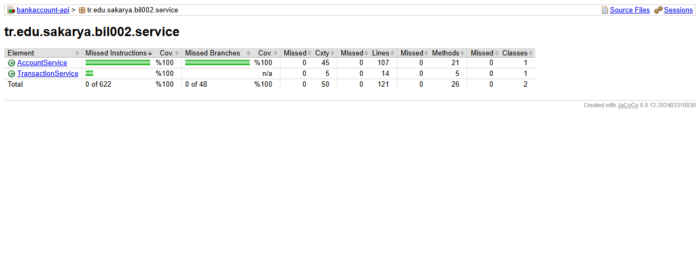
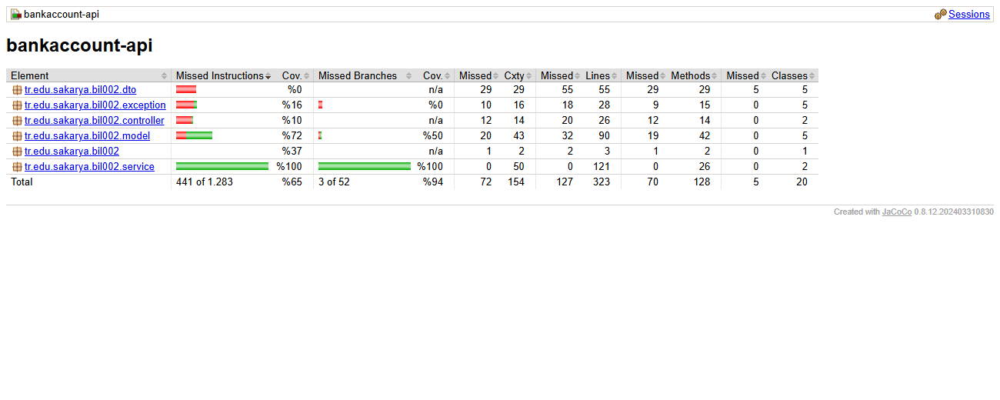
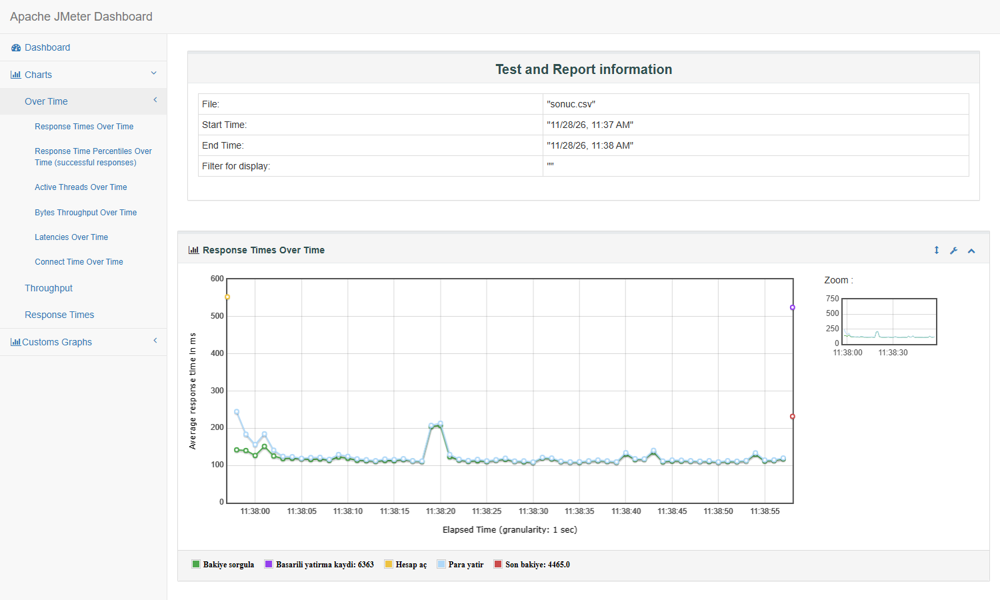
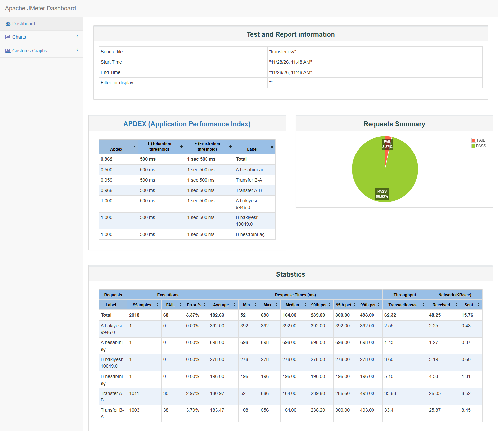
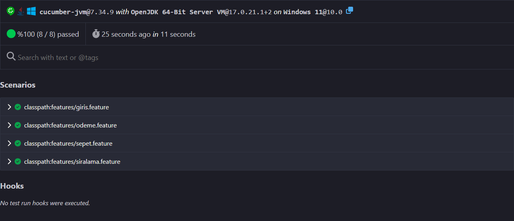

# BIL 002 Dönem Projesi Test Raporu

**Öğrenci Adı:** _(Gün 19'da doldurulacak)_  
**Öğrenci No:** _(Gün 19'da doldurulacak)_  
**Tarih:** _(Gün 19'da doldurulacak)_  
**Kısım 1 Repo URL (BankAccount):** https://github.com/Oruc74/bil002-bankaccount  
**Kısım 2 Repo URL (Selenium + Cucumber):** https://github.com/Oruc74/bil002-selenium

Bu rapor BYS üzerinden teslim edilir. Aşağıdaki Bölüm 1–10 Kısım 1'i, en sondaki Kısım 2 başlığı ise Selenium/Cucumber çalışmasını kapsar.

> **Çalışma notu:** Bu dosya bir iskelettir. Her bölümdeki "Durum" satırı bölümün hangi aşamada doldurulacağını gösterir. Teslimden önce bu satırlar ve `<!-- -->` yorumları silinecek, doğrulanmamış bilgi bırakılmayacak.

---

# KISIM 1 — BankAccount API Testleri

## 1. Statik Test Sonuçları
(SonarQube / Checkstyle bulguları)

> Durum: Checkstyle ve elle kod incelemesi Gün 7'de dolduruldu. SonarQube for IDE bulguları eklenecek.

| # | Araç | Dosya:Satır | Kural / Bulgu | Önem | Yorum |
|---|------|-------------|---------------|------|-------|
| 1 | Checkstyle 10.17.0 | `src/main/java` (tümü) | `mvn -B checkstyle:check`: 0 ihlal | — | `checkstyle.xml` adlandırma, import, süslü parantez, girinti ve satır uzunluğu gibi biçim kurallarını denetliyor, iş kuralı hatası aramıyor. Test kodları yapılandırmada kapsam dışı. |
| 2 | Kod incelemesi (elle) | `AccountService.java:171` | Faiz `balance.longValue()` ve tam sayı bölmesiyle hesaplanıyor, kuruşlar kayboluyor | Kritik | H-09. `wb01` ve `wb02` testleriyle kanıtlandı. |
| 3 | Kod incelemesi (elle) | `AccountService.java:193` | `validateTransferParties` hedef hesabı parametre olarak alıyor ama hiç kontrol etmiyor | Kritik | H-07. `kt03` ve `kt06` testleriyle kanıtlandı. |
| 4 | Kod incelemesi (elle) | `TransactionService.java:41-49` | Günlük çekim toplamında tarih filtresi yok, bütün geçmiş toplanıyor | Yüksek | H-12. `zm01`, `zm02`, `zm03` testleriyle kanıtlandı. |
| 5 | Kod incelemesi (elle) | `AccountService.java:242-245`, `Account.java:24-25` | Hesap numarası rastgele üretiliyor; kodda tekrar kontrolü, veritabanında unique kısıtı yok (R-1.5) | Orta | 500 eşzamanlı hesap açmada tekrar çıkmadı, bu yüzden testle gösterilemedi; benzersizlik garanti değil. |

---

## 2. Kara Kutu Test Vakaları

> Durum: 2.1 ve 2.2 Gün 4'te, 2.3 Gün 5'te, 2.4 Gün 6'da doldurulacak. Test ID ile test metodu adı eşleşecek.

### 2.1 Denklik Sınıfı Tablosu

| Test ID | Giriş | Beklenen | Gerçekleşen | Sonuç |
|---------|-------|----------|-------------|-------|
| EP-01 | STANDARD, bakiye 1.000; 500 TL yatır | Bakiye 1.500, DEPOSIT/SUCCESS kaydı (R-2.5, R-2.6) | Bakiye 1.500, SUCCESS kaydı oluştu | ✔ |
| EP-02 | PREMIUM, bakiye 1.000; 0 TL yatır | Reddedilir, FAILED kaydı (R-2.2, R-2.7) | Reddedilmedi | ✘ (H-03) |
| EP-03 | Bakiye 1.000; -100 TL yatır | Reddedilir, bakiye aynı, FAILED kaydı (R-2.2, R-2.7) | Reddedildi, bakiye aynı; FAILED kaydı oluşmadı | ✘ (H-01) |
| EP-04 | FROZEN hesap, bakiye 1.000; 500 TL yatır | Reddedilir, bakiye ve durum aynı, FAILED kaydı (R-2.3, R-2.7) | Reddedildi, bakiye ve durum aynı; FAILED kaydı oluşmadı | ✘ (H-01) |
| EP-05 | CLOSED hesap; 500 TL yatır | Reddedilir, bakiye ve durum aynı, FAILED kaydı (R-2.3, R-2.7) | Reddedildi, bakiye ve durum aynı; FAILED kaydı oluşmadı | ✘ (H-01) |
| EP-06 | Bakiye 1.000; 200 TL çek | Bakiye 800, WITHDRAWAL/SUCCESS kaydı (R-3.6, R-3.7) | Bakiye 800, SUCCESS kaydı oluştu | ✔ |
| EP-07 | FROZEN hesap, bakiye 1.000; 100 TL çek | Reddedilir, bakiye aynı, FAILED kaydı (R-3.3, R-3.8) | Reddedilmedi, para çekildi (bakiye 900) | ✘ (H-02) |
| EP-08 | Hesap sahibi adı: null, "", "   " | Reddedilir, hesap açılmaz (R-1.1) | Üçü de reddedildi | ✔ |
| EP-09 | Hesap türü: "GOLD", "standard", "STANDARD " (sonda boşluk), "", null | Reddedilir, hesap açılmaz (R-1.2) | Hepsi reddedildi | ✔ |
| EP-10 | Başlangıç bakiyesi -100 | Reddedilir, hesap açılmaz (R-1.4) | Reddedilmedi, -100 bakiyeli hesap açıldı | ✘ (H-06) |
| EP-11 | Geçerli bilgiler: PREMIUM, 100 TL | ACTIVE hesap, 10 haneli numara, geçmiş boş (R-1.2, R-1.5, R-1.6, R-1.7) | Beklendiği gibi | ✔ |
| EP-12 | Başlangıç bakiyesi verilmez (null) | Bakiye 0 (R-1.3) | Bakiye 0 | ✔ |
| EP-13 | Olmayan hesaba 100 TL yatır | "Hesap bulunamadı" hatası (R-2.1) | "Hesap bulunamadı" hatası | ✔ |
| EP-14 | Olmayan hesaptan 100 TL çek | "Hesap bulunamadı" hatası (R-3.1) | "Hesap bulunamadı" hatası | ✔ |
| EP-15 | Bakiye 1.000; -100 TL çek | Reddedilir, bakiye aynı, FAILED kaydı (R-3.2, R-3.8) | Reddedildi, bakiye aynı; FAILED kaydı oluşmadı | ✘ (H-01) |
| EP-16 | STANDARD; art arda iki kez 6.000 TL yatır | İkisi de kabul: limit tek işlem içindir (R-2.4) | Bakiye 12.000 | ✔ |
| EP-17 | STANDARD, bakiye 10.000; 6.000 TL çekme denemesi, sonra 5.000 TL çek | Reddedilen deneme limite sayılmaz, 5.000 TL çekilir (R-3.5) | Bakiye 5.000 | ✔ |
| EP-18 | CLOSED hesap (bakiye 0); 1 TL çek | Reddedilir, bakiye ve durum aynı, FAILED kaydı (R-3.3, R-3.8) | Reddedildi, bakiye ve durum aynı; FAILED kaydı oluşmadı | ✘ (H-01) |

### 2.2 Sınır Değer Analizi Tablosu

| Test ID | Değişken | Sınır | Test Değeri | Beklenen | Gerçekleşen | Sonuç |
|---------|----------|-------|-------------|----------|-------------|-------|
| BVA-01 | Yatırma tutarı | 0 | -0,01 | Reddedilir, FAILED kaydı (R-2.2, R-2.7) | Reddedildi; FAILED kaydı oluşmadı | ✘ (H-01) |
| BVA-02 | Yatırma tutarı | 0 | 0,00 | Reddedilir, FAILED kaydı (R-2.2, R-2.7) | Reddedilmedi | ✘ (H-03) |
| BVA-03 | Yatırma tutarı | 0 | 0,01 | Kabul, bakiye 1.000,01 (G-1, R-2.2) | Bakiye 1.000,01 | ✔ |
| BVA-04 | STANDARD yatırma limiti | 10.000 | 9.999,99 | Kabul (R-2.4) | Kabul edildi | ✔ |
| BVA-05 | STANDARD yatırma limiti | 10.000 | 10.000,00 | Kabul (R-2.4) | Kabul edildi | ✔ |
| BVA-06 | STANDARD yatırma limiti | 10.000 | 10.000,01 | Reddedilir, FAILED kaydı (R-2.4, R-2.7) | Reddedildi; FAILED kaydı oluşmadı | ✘ (H-01) |
| BVA-07 | PREMIUM yatırma limiti | 50.000 | 49.999,99 | Kabul (R-2.4) | Kabul edildi | ✔ |
| BVA-08 | PREMIUM yatırma limiti | 50.000 | 50.000,00 | Kabul (R-2.4) | Kabul edildi | ✔ |
| BVA-09 | PREMIUM yatırma limiti | 50.000 | 50.000,01 | Reddedilir, FAILED kaydı (R-2.4, R-2.7) | Reddedildi; FAILED kaydı oluşmadı | ✘ (H-01) |
| BVA-10 | Çekim tutarı | 0 | -0,01 | Reddedilir, FAILED kaydı (R-3.2, R-3.8) | Reddedildi; FAILED kaydı oluşmadı | ✘ (H-01) |
| BVA-11 | Çekim tutarı | 0 | 0,00 | Reddedilir, FAILED kaydı (R-3.2, R-3.8) | Reddedildi; FAILED kaydı oluşmadı | ✘ (H-01) |
| BVA-12 | Çekim tutarı | 0 | 0,01 | Kabul, bakiye 999,99 (G-1, R-3.2) | Bakiye 999,99 | ✔ |
| BVA-13 | Çekim tutarı (bakiye 1.000) | Tam bakiye | 999,99 | Kabul, bakiye 0,01 (R-3.4) | Bakiye 0,01 | ✔ |
| BVA-14 | Çekim tutarı (bakiye 1.000) | Tam bakiye | 1.000,00 | Kabul, bakiye 0 (R-3.4) | "Yetersiz bakiye" ile reddedildi | ✘ (H-04) |
| BVA-15 | Çekim tutarı (bakiye 1.000) | Tam bakiye | 1.000,01 | Reddedilir, FAILED kaydı (R-3.4, R-3.8) | Reddedildi; FAILED kaydı oluşmadı | ✘ (H-01) |
| BVA-16 | STANDARD günlük çekim toplamı | 5.000 | 3.000 + 1.999,99 | Kabul (R-3.5) | Kabul edildi | ✔ |
| BVA-17 | STANDARD günlük çekim toplamı | 5.000 | 3.000 + 2.000 | Kabul, bakiye 5.000 (R-3.5) | Bakiye 5.000 | ✔ |
| BVA-18 | STANDARD günlük çekim toplamı | 5.000 | 3.000 + 2.000,01 | İkinci çekim reddedilir, FAILED kaydı (R-3.5, R-3.8) | Reddedildi, bakiye 7.000; FAILED kaydı oluşmadı | ✘ (H-01) |
| BVA-19 | PREMIUM günlük çekim toplamı | 20.000 | 12.000 + 7.999,99 | Kabul (R-3.5) | Kabul edildi | ✔ |
| BVA-20 | PREMIUM günlük çekim limiti | 20.000 | 20.000,00 | Kabul, bakiye 10.000 (R-3.5) | "Günlük çekim limiti aşıldı" ile reddedildi | ✘ (H-05) |
| BVA-21 | PREMIUM günlük çekim limiti | 20.000 | 20.000,01 | Reddedilir, FAILED kaydı (R-3.5, R-3.8) | Reddedildi; FAILED kaydı oluşmadı | ✘ (H-01) |
| BVA-22 | Başlangıç bakiyesi | 0 | -0,01 | Reddedilir, hesap açılmaz (R-1.4) | Reddedilmedi, hesap açıldı | ✘ (H-06) |
| BVA-23 | Başlangıç bakiyesi | 0 | 0,00 | Kabul, ACTIVE, geçmiş boş (R-1.4, R-1.6, R-1.7) | Beklendiği gibi | ✔ |
| BVA-24 | Başlangıç bakiyesi | 0 | 0,01 | Kabul, bakiye 0,01 (R-1.4) | Bakiye 0,01 | ✔ |

### 2.3 Karar Tablosu

#### Transfer

Koşullar ve beklenen eylemler R-4.1–R-4.8 ile G-4 ve G-5’e dayanır. HTTP kodları servis sonuçlarının API karşılıklarını gösterir. İki tablonun sonuçları `test-sonuclari.txt` dosyasındaki sınıf çalıştırmasından alınmıştır.

| Koşul / Eylem | K1 | K2 | K3 | K4 | K5 | K6 | K7 | K8 | K9 | K10 | K11 | K12 | K13 | K14 |
| --- | --- | --- | --- | --- | --- | --- | --- | --- | --- | --- | --- | --- | --- | --- |
| **Koşullar** |  |  |  |  |  |  |  |  |  |  |  |  |  |  |
| Kaynak hesabın durumu | ACTIVE | FROZEN | ACTIVE | ACTIVE | CLOSED | ACTIVE | ACTIVE | Hesap yok | ACTIVE | ACTIVE | ACTIVE | ACTIVE | ACTIVE | ACTIVE |
| Hedef hesabın durumu | ACTIVE | ACTIVE | FROZEN | ACTIVE | ACTIVE | CLOSED | ACTIVE | ACTIVE | Hesap yok | ACTIVE | ACTIVE | ACTIVE | ACTIVE | ACTIVE |
| Kaynak ve hedef aynı hesap mı? | Hayır | Hayır | Hayır | Evet | Hayır | Hayır | Hayır | Hayır | Hayır | Hayır | Hayır | Hayır | Hayır | Hayır |
| Kaynak bakiyesi (TL) | 1.000 | 1.000 | 1.000 | 1.000 | 0 | 1.000 | 100 | — | 1.000 | 1.000 | 1.000 | 1.000 | 70.000 | 10.000 |
| Transfer tutarı (TL) | 250 | 250 | 250 | 250 | 250 | 250 | 100,01 | 250 | 250 | 0 | -100 | 1.000 | 60.000 | 1.000 |
| Tutar pozitif mi? | Evet | Evet | Evet | Evet | Evet | Evet | Evet | Evet | Evet | Hayır | Hayır | Evet | Evet | Evet |
| Kaynak bakiyesi yeterli mi? | Evet | Evet | Evet | Evet | Hayır | Evet | Hayır | — | Evet | Evet | Evet | Evet, tam bakiye | Evet | Evet |
| Transferden sonra kaynaktan çekim isteği (TL) | — | — | — | — | — | — | — | — | — | — | — | — | — | 5.000 |
| **Beklenen eylemler** |  |  |  |  |  |  |  |  |  |  |  |  |  |  |
| Transfer yanıtının HTTP karşılığı | 200 | 409 | 409 | 400 | 409 veya 422 | 409 | 422 | 404 | 404 | 400 | 400 | 200 | 200 | 200 |
| Tutarı kaynaktan düş ve hedefe ekle | ✔ | — | — | — | — | — | — | — | — | — | — | ✔ | ✔ | ✔ |
| İki hesap için de `TRANSFER/SUCCESS` kaydı oluştur | ✔ | — | — | — | — | — | — | — | — | — | — | ✔ | ✔ | ✔ |
| Mevcut hesapların bakiyesini ve durumunu koru | — | ✔ | ✔ | ✔ | ✔ | ✔ | ✔ | ✔ | ✔ | ✔ | ✔ | — | — | — |
| `TRANSFER/SUCCESS` kaydı oluşturma | — | ✔ | ✔ | ✔ | ✔ | ✔ | ✔ | ✔ | ✔ | ✔ | ✔ | — | — | — |
| Kaynağın 5.000 TL çekimini kabul et | — | — | — | — | — | — | — | — | — | — | — | — | — | ✔ |
| Test ID | KT-01 | KT-02 | KT-03 | KT-04 | KT-05 | KT-06 | KT-07 | KT-08 | KT-09 | KT-10 | KT-11 | KT-12 | KT-13 | KT-14 |
| Sonuç | ✔ | ✔ | ✘ (H-07) | ✘ (H-08) | ✔ | ✘ (H-07) | ✔ | ✔ | ✔ | ✔ | ✔ | ✔ | ✔ | ✔ |

K5’te kaynak kapalı ve sıfır bakiyelidir. Pozitif tutar hem durum hem bakiye kuralını ihlal ettiği için 409 veya 422 kabul edilir. K8 ve K9’da bakiye, durum ve geçmiş denetimi mevcut hesapta yapılır. K13’teki 60.000 TL, belgelenen yatırma ve günlük çekim limitlerinin üzerindedir.

#### Yatırma ve günlük çekim limitleri

R-2.4 ve R-3.5 için hesap aktiftir, istek tutarı pozitiftir ve çekim için bakiye yeterlidir. Yatırmada istek tutarı, çekimde önceki başarılı günlük çekimlerle istek tutarının toplamı limitle karşılaştırılır. Limit dahilindeki sütunlarda tam sınır değeri kullanılır.

| Koşul / Eylem | L1 | L2 | L3 | L4 | L5 | L6 | L7 | L8 |
| --- | --- | --- | --- | --- | --- | --- | --- | --- |
| **Koşullar** |  |  |  |  |  |  |  |  |
| İşlem | Yatırma | Yatırma | Yatırma | Yatırma | Günlük çekim | Günlük çekim | Günlük çekim | Günlük çekim |
| Hesap türü | STANDARD | STANDARD | PREMIUM | PREMIUM | STANDARD | STANDARD | PREMIUM | PREMIUM |
| Bugün daha önceki başarılı çekimlerin toplamı (TL) | — | — | — | — | 3.000 | 3.000 | 0 | 0 |
| İstek tutarı (TL) | 10.000 | 10.000,01 | 50.000 | 50.000,01 | 2.000 | 2.000,01 | 20.000 | 20.000,01 |
| Limitle karşılaştırılan tutar (TL) | 10.000 | 10.000,01 | 50.000 | 50.000,01 | 5.000 | 5.000,01 | 20.000 | 20.000,01 |
| İlgili limit (TL) | 10.000 | 10.000 | 50.000 | 50.000 | 5.000 | 5.000 | 20.000 | 20.000 |
| Tutar limit dahilinde mi? | Evet (eşit) | Hayır | Evet (eşit) | Hayır | Evet (eşit) | Hayır | Evet (eşit) | Hayır |
| **Beklenen eylemler** |  |  |  |  |  |  |  |  |
| Kabul et, bakiyeyi güncelle ve `SUCCESS` kaydı oluştur (HTTP 200) | ✔ | — | ✔ | — | ✔ | — | ✔ | — |
| Limiti aştığı için reddet, bakiyeyi koru ve `FAILED` kaydı oluştur (HTTP 422) | — | ✔ | — | ✔ | — | ✔ | — | ✔ |
| Test ID | BVA-05 | BVA-06 | BVA-08 | BVA-09 | BVA-17 | BVA-18 | BVA-20 | BVA-21 |
| Sonuç | ✔ | ✘ (H-01) | ✔ | ✘ (H-01) | ✔ | ✘ (H-01) | ✘ (H-05) | ✘ (H-01) |

H-01 yüzünden kırmızı olan BVA-06, BVA-09, BVA-18 ve BVA-21’de limit aşımı `LimitExceededException` ile doğru şekilde reddedildi ve bakiye korundu. Bu sütunlarda yalnızca reddedilen denemeye ait `FAILED` kaydı eksikti.

### 2.4 Durum Geçiş Tablosu

| Test ID | Başlangıç Durumu | Olay | Beklenen Durum | Gerçekleşen Durum | Sonuç |
|---------|------------------|------|----------------|-------------------|-------|
| ST-01 | ACTIVE | `freezeAccount` | FROZEN, başarılı | FROZEN, başarılı | ✔ |
| ST-02 | ACTIVE | `unfreezeAccount` | ACTIVE, ret (409) | ACTIVE, reddedildi | ✔ |
| ST-03 | ACTIVE | `closeAccount` (0 TL) | CLOSED, başarılı | CLOSED, başarılı | ✔ |
| ST-04 | ACTIVE | `closeAccount` (0,01 TL) | ACTIVE, ret (409) | CLOSED, HTTP 200, bakiye 0,01 TL kaldı | ✘ (H-10) |
| ST-05 | FROZEN | `freezeAccount` | FROZEN, ret (409) | FROZEN, HTTP 200 | ✘ (H-11) |
| ST-06 | FROZEN | `unfreezeAccount` | ACTIVE, başarılı | ACTIVE, başarılı | ✔ |
| ST-07 | FROZEN | `closeAccount` (0 TL) | CLOSED, başarılı | CLOSED, başarılı | ✔ |
| ST-08 | FROZEN | `closeAccount` (0,01 TL) | FROZEN, ret (409) | Kapatma kabul edildi. API’de 100 TL bakiyeli FROZEN hesap CLOSED oldu, bakiye korundu | ✘ (H-10) |
| ST-09 | CLOSED | `freezeAccount` | CLOSED, ret (409) | CLOSED, reddedildi | ✔ |
| ST-10 | CLOSED | `unfreezeAccount` | CLOSED, ret (409) | CLOSED, reddedildi | ✔ |
| ST-11 | CLOSED | `closeAccount` | CLOSED, ret (409) | CLOSED, reddedildi | ✔ |

#### Diğer kural testleri

| Test ID | Kural | Beklenen | Sonuç |
|---------|-------|----------|-------|
| EP-18 | R-3.3, R-3.8, §4.3 | CLOSED hesapta çekim reddedilir, durum ve bakiye korunur ve geçmişte WITHDRAWAL/FAILED görünür | ✘ (H-01), FAILED kaydı yok |
| FZ-01 | R-8.2–R-8.5 | STANDARD 1.000 TL → 1.002,50 TL, INTEREST/SUCCESS tutarı 2,50 TL | ✘ (H-09), bakiye 1.002,00 TL |
| FZ-02 | R-8.2–R-8.5 | PREMIUM 1.000 TL → 1.004,17 TL, INTEREST/SUCCESS tutarı 4,17 TL | ✘ (H-09), bakiye 1.004,00 TL |
| FZ-03 | R-8.3–R-8.5 | 0,005 TL faiz 0,01 TL’ye yuvarlanır, bakiye 2,01 TL olur ve INTEREST/SUCCESS kaydı oluşur | ✘ (H-09), bakiye 2,00 TL |
| FZ-04 | R-8.1, §4.3 | FROZEN hesaba faiz reddedilir, durum ve bakiye korunur | ✔ |
| FZ-05 | R-8.1, §4.3 | CLOSED hesaba faiz reddedilir, durum ve bakiye korunur | ✔ |
| FZ-06 | R-8.2–R-8.5 | STANDARD 12.000 TL → 12.030,00 TL, INTEREST/SUCCESS tutarı 30,00 TL | ✔ |
| FZ-07 | R-8.2–R-8.5 | PREMIUM 2.500,50 TL → 2.510,92 TL, INTEREST/SUCCESS tutarı 10,42 TL | ✘ (H-09), bakiye 2.510,50 TL |
| FZ-08 | R-8.2–R-8.5 | STANDARD 0,00 TL → 0,00 TL, INTEREST/SUCCESS tutarı 0,00 TL | ✔ |
| IG-01 | R-9.1 | Olmayan hesabın geçmişi için AccountNotFoundException (404) | ✔ |
| IG-02 | R-9.3 | İki yatırma kaydından en yenisi ilk sırada döner | ✔ |
| IG-03 | R-9.2 | Geçmişte SUCCESS ve FAILED kayıtları birlikte döner | ✘ (H-01), yalnız SUCCESS kaydı döndü |
| IG-04 | R-9.4 | Hesap dondurulduktan sonra önceki yatırma kaydı geçmişte döner | ✔ |
| HS-01 | R-10.1, §4.3 | ACTIVE, FROZEN ve CLOSED hesapların bilgisi döner | ✔ |
| HS-02 | R-10.2 | Olmayan hesap için AccountNotFoundException (404) | ✔ |

## 3. Beyaz Kutu Test Sonuçları
(JaCoCo ekran görüntüsü ve açıklama)

Kapsama JaCoCo 0.8.12 ile ölçüldü: `mvn -B clean test "-Dmaven.test.failure.ignore=true"`. `@Tag("hata")` testleri dahil 99 test çalıştı; 37'si bilinen hatalar yüzünden kırmızı. Düz `mvn test` bu kırmızı testlerde `BUILD FAILURE` verip kapsama raporu üretmediği için hata yok sayma seçeneği kullanıldı. Ham veri: [kapsama/jacoco.csv](kapsama/jacoco.csv).

- Branch Coverage: servis paketi %100 (48/48), tüm proje %94,2 (49/52)
- Statement Coverage (satır): servis paketi %100 (121/121), tüm proje %60,7 (196/323)





### Dal tablosu (AccountService)

Her koşulun doğru ve yanlış olmak üzere iki dalı vardır. `TransactionService` içinde koşul yoktur (0 dal); 14 satırının tamamı çalıştı.

| Metot | Dal (koşul) | Test Metodu (doğru / yanlış) | Kapsandı mı? |
|-------|-------------|------------------------------|--------------|
| createAccount | `ownerName == null` | EP-08 / EP-11 | ✔ |
| createAccount | `ownerName.isBlank()` | EP-08 / EP-11 | ✔ |
| createAccount | `!STANDARD.equals(accountType)` | EP-11 / EP-12 | ✔ |
| createAccount | `!PREMIUM.equals(accountType)` | EP-09 / EP-11 | ✔ |
| createAccount | `initialBalance != null` | EP-11 / EP-12 | ✔ |
| deposit | `amount == null` | wb05 / EP-01 | ✔ |
| deposit | `amount < 0` | EP-03 / EP-01 | ✔ |
| withdraw | `amount == null` | wb06 / EP-06 | ✔ |
| withdraw | `amount <= 0` | BVA-11 / EP-06 | ✔ |
| transfer | `amount == null` | wb07 / KT-01 | ✔ |
| transfer | `amount <= 0` | KT-10 / KT-01 | ✔ |
| transfer | `source.getBalance() < amount` | KT-07 / KT-12 | ✔ |
| freezeAccount | `status == CLOSED` | ST-09 / ST-01 | ✔ |
| unfreezeAccount | `status != FROZEN` | ST-02 / ST-06 | ✔ |
| closeAccount | `status == CLOSED` | ST-11 / ST-03 | ✔ |
| calculateInterest | tür `PREMIUM` mu? (%5 / %3) | wb02 / wb01 | ✔ |
| requireActive | `status != ACTIVE` | EP-04 / EP-01 | ✔ |
| validateTransferParties | `source.getStatus() != ACTIVE` | KT-02 / KT-01 | ✔ |
| ensureSufficientBalance | `amount >= account.getBalance()` | BVA-14 / BVA-13 | ✔ |
| checkDepositLimit | tür `PREMIUM` mu? (50.000 / 10.000) | BVA-08 / BVA-05 | ✔ |
| checkDepositLimit | `amount > limit` | BVA-06 / BVA-05 | ✔ |
| checkDailyWithdrawalLimit | tür `PREMIUM` mu? | wb04 / wb03 | ✔ |
| checkDailyWithdrawalLimit | PREMIUM: `total >= 20.000` | wb04 / BVA-19 | ✔ |
| checkDailyWithdrawalLimit | STANDARD: `total > 5.000` | wb03 / wb03 | ✔ |

`findAccount` metodunda koşul yoktur; hesap var ve yok durumları wb08 ve wb09 ile çalıştırıldı.

### Zamana bağlı kurallar

Uygulamanın saati testten değiştirilemiyor ve `src/main` değiştirilmiyor. Bu yüzden `ZamanKurallariTest` işlemi normal yoldan yapıyor, sonra kaydın `timestamp` alanını `TransactionRepository` ile geçmişe alıyor. zm01–zm03 dünkü çekimlerin bugünkü limite sayılmamasını (R-3.5, G-6), zm04 işlem geçmişinin yeniden eskiye sıralanmasını (R-9.3) sınıyor. zm04 geçti, zm01–zm03 kaldı (H-12).

### Kapsanamayan dallar ve nedenleri

Servis paketinde kapsanmayan dal yok. Projede kalan 3 dal:

- `GlobalExceptionHandler`, `ex instanceof ErrorResponse` (2 dal): Bu sınıf yalnız HTTP isteklerinde devreye girer. Testler servis metotlarını doğrudan çağırıyor.
- `Transaction.onCreate`, `timestamp == null` koşulunun yanlış dalı (1 dal): Uygulama kaydı hiçbir zaman hazır bir zamanla oluşturmuyor; testler de zamanı kayıttan sonra değiştiriyor.

Tüm projede satır oranının düşük kalmasının nedeni HTTP katmanı (`controller`, `dto`, `GlobalExceptionHandler`) ve `model` sınıflarının testlerde kullanılmayan getter/setter metotlarıdır.

%100 dal kapsaması hatasızlık anlamına gelmiyor. H-02, H-10 ve H-12 gibi hatalar kodda hiç yazılmamış kontrollerdir; kapsama raporu olmayan kodu gösteremez. Bunlar gereksinimden yazılan testlerle bulundu.

---

## 4. TDD Uygulaması

`POST /api/accounts/{accountNumber}/upgrade` ile bakiyesi en az 1.000 TL olan `ACTIVE` durumundaki `STANDARD` hesap `PREMIUM` türüne yükseltilir. Başarı yanıtı güncellenmiş hesabı içerir.

### Kırmızı (Red)

`AccountUpgradeIntegrationTest` sınıfı HTTP yanıtını, güncellenmiş hesabın tekrar sorgulanabilmesini ve reddedilen işlemlerde hesabın aynı kalmasını doğrular. Beklenen hata kodları Gereksinimler Bölüm 7'ye göre seçildi.

| Test | Senaryo | Beklenen yanıt |
|------|---------|----------------|
| TDD-01 | Aktif STANDARD hesap, 1.000,00 TL ve 1.000,01 TL | `200 OK`, hesap türü PREMIUM |
| TDD-02 | Aktif STANDARD hesap, 999,99 TL | `422 Unprocessable Entity`, yetersiz bakiye |
| TDD-03 | Yeterli bakiyesi olan FROZEN ve CLOSED hesaplar | `409 Conflict`, hesap durumu uygun değil |
| TDD-04 | Aktif ve yeterli bakiyesi olan PREMIUM hesap | `409 Conflict`, hesap türü geçişe uygun değil |
| TDD-05 | Hesap mevcut değil | `404 Not Found`, hesap bulunamadı mesajı |

`mvn -B test -Dtest=AccountUpgradeIntegrationTest` komutuyla yapılan ilk çalıştırmada yükseltme yolu henüz tanımlı olmadığı için yedi senaryonun tamamı başarısız oldu. TDD-05, hesabın bulunamaması ile yolun bulunamamasını hata mesajından ayırt etti.

```text
[ERROR]   AccountUpgradeIntegrationTest.tdd01_upgrade_yeterliBakiyePremiumOlmali:40 Status expected:<200> but was:<404>
[ERROR]   AccountUpgradeIntegrationTest.tdd02_upgrade_limitinBirKurusAltiReddedilmeli:55 Status expected:<422> but was:<404>
[ERROR]   AccountUpgradeIntegrationTest.tdd03_upgrade_aktifOlmayanHesapReddedilmeli:67 Status expected:<409> but was:<404>
[ERROR] Tests run: 7, Failures: 7, Errors: 0, Skipped: 0
```

### Yeşil (Green)

`AccountService` hesabı yükler ve durum, tür, bakiye koşullarını kontrol eder. Uygun hesabın türünü `PREMIUM` olarak kaydeder. `AccountController` güncellenen hesabı `200 OK` ile döndürür. Reddedilen isteklerde mevcut istisna işleyicisi uygun HTTP kodunu ve hata gövdesini üretir.

### Yeniden düzenleme (Refactor)

`MIN_PREMIUM_UPGRADE_BALANCE` sabiti bakiye kontrolüne ve yetersiz bakiye mesajına aynı tutarı sağlar. Eşik değişirse tek bir değeri güncellemek yeterlidir.

Yeşil ve yeniden düzenleme adımlarında `mvn -B checkstyle:check test -DexcludedGroups=hata` komutuyla 69 testin tamamı geçti. Checkstyle 0 ihlal bildirdi.

### TDD commit’leri

| Adım | Commit |
|------|--------|
| Kırmızı | `4bb3eb44a1adf6e916198d76f5977dd9edb1ebf3` |
| Yeşil | `a883c6475d93f90092d5c5be78bd2686cfa47790` |
| Yeniden düzenleme | `006abadec924e13220943fdba3e43f809b824c33` |

---

## 5. BDD Senaryoları

Beş feature dosyasındaki 22 senaryo, hesap işlemlerinin sonucunu bakiye, hesap durumu ve işlem geçmişi üzerinden doğrular. `Scenario Outline` içindeki her `Examples` satırı bir senaryo olarak çalışır.

| Feature Dosyası | Senaryo Sayısı | Açıklama | Sonuç |
|-----------------|----------------|----------|-------|
| `para_yatirma.feature` | 3 | Kuruşlu tutarda ve tam limitte yatırma, 0 TL yatırmanın reddi | 2 geçti, 1 `@hata` (H-03) |
| `para_cekme.feature` | 3 | Geçerli çekim, yetersiz bakiye ve dondurulmuş hesaptan çekimin reddi | 2 geçti, 1 `@hata` (H-02) |
| `transfer.feature` | 3 | İki hesabın bakiyesi ve işlem kayıtları, yetersiz bakiye ve dondurulmuş hedef | 2 geçti, 1 `@hata` (H-07) |
| `hesap_durumu.feature` | 5 | Dondurma, yeniden etkinleştirme, sıfır bakiyeli hesabı kapatma, bakiyeli hesabı kapatma ve tekrar dondurma girişimleri | 3 geçti, 2 `@hata` (H-10 ve H-11) |
| `faiz.feature` | 8 | STANDARD ve PREMIUM aylık faizi, kuruşa yuvarlama, sıfır bakiye ve aktif olmayan hesapta ret | 5 geçti, 3 `@hata` (H-09) |

Faiz taslağında kuruşlu faiz beklenen üç örnek, H-09'u yakalayan `@hata` etiketli `Examples` bloğunda yer alır. `mvn -B test -Dtest=CucumberRunnerTest` komutuyla, örnek dosyadaki iki senaryo dahil 24 senaryo çalıştı. 16 senaryo geçti ve 8 senaryo bilinen hataları yakaladı.

`mvn -B checkstyle:check test -DexcludedGroups=hata` ile 83 test geçti ve Checkstyle 0 ihlal bildirdi. `mvn -B test -Dgroups=hata` çalıştırmasında beklenen şekilde başarısız olan 45 testin 8'i Cucumber senaryosuydu.

---

## 6. Entegrasyon ve API Testleri
(Postman koleksiyonu özeti)

### Entegrasyon testleri (MockMvc)

`AccountControllerIntegrationTest` (it01–it23) ve `TransactionControllerIntegrationTest` (it24–it29) HTTP kodunu, JSON gövdesini ve Bölüm 7 hata alanlarını doğruluyor. Yükseltme özelliği `AccountUpgradeIntegrationTest` (TDD, 7 senaryo) ile sınanıyor. Bilinen hatalar nedeniyle 9 test başarısız: it01 (H-13), it04 (H-06), it07 (H-03), it08 (H-04), it09 (H-02), it11 (H-11), it15 (H-10), it25 (H-07), it28 (H-08). API belgesinde `GET /api/accounts` için hata durumu tanımlanmıyor.

### Postman koleksiyonu

Koleksiyon dosyası `docs/postman/bankaccount.postman_collection.json`. İstekler adresi `{{baseUrl}}` ortam değişkeninden alıyor. Her senaryo yeni hesap açıyor ve hesap numarasını `pm.environment.set` ile sonraki isteklere taşıyor. Koleksiyonda 51 kontrol isteği (API-01–API-51), 67 hazırlık ve 31 doğrulama isteği var (toplam 149). Ortam dosyası token içerdiği için repoya konmadı.

### Canlı servis kabul testi

Koleksiyon 28.11.2026'da canlı servis örneğine karşı Newman 6.2.1 (Postman'in komut satırı çalıştırıcısı) ile çalıştırıldı. 149 istekte 298 `pm.test` doğrulaması yapıldı ve 28 doğrulama başarısız oldu. 51 kontrol isteğinin 37'si geçti, 14'ü kaldı. Yerel uygulamada aynı koleksiyon aynı sonucu verdi.

API-16, API-19 ve API-26 sonrasındaki doğrulama istekleri bakiye veya durumun değiştiğini gösterdi (G-4). Bu çalıştırmada yalnız canlı serviste görülen bir hata çıkmadı. Eşzamanlı davranış Bölüm 7'de ayrıca sınandı. Günlük limitin gün değişince sıfırlanması (H-12) canlı serviste denenemedi, çünkü sunucu saati değiştirilemiyor.

| Test ID | Metot | Endpoint | Beklenen Kod | Gerçekleşen Kod | Sonuç |
|---------|-------|----------|--------------|-----------------|-------|
| API-01 | POST | `/api/accounts` | 201 | 201 | ✔ |
| API-02 | POST | `/api/accounts` | 201 | 201 | ✔ |
| API-03 | POST | `/api/accounts` | 400 | 201 | ✘ (H-06) |
| API-04 | POST | `/api/accounts` | 400 | 400 | ✔ |
| API-05 | POST | `/api/accounts` | 400 | 400 | ✔ |
| API-06 | POST | `/api/accounts/{no}/deposit` | 200 | 200 | ✔ |
| API-07 | POST | `/api/accounts/{no}/deposit` | 422 | 422 | ✔ |
| API-08 | GET | `/api/accounts/{no}/transactions` | 200 | 200 | ✘ (H-01) |
| API-09 | POST | `/api/accounts/{no}/deposit` | 400 | 200 | ✘ (H-03) |
| API-10 | POST | `/api/accounts/{no}/deposit` | 409 | 409 | ✔ |
| API-11 | POST | `/api/accounts/{no}/withdraw` | 200 | 200 | ✔ |
| API-12 | POST | `/api/accounts/{no}/withdraw` | 422 | 422 | ✔ |
| API-13 | POST | `/api/accounts/{no}/withdraw` | 422 | 422 | ✔ |
| API-14 | POST | `/api/accounts/{no}/withdraw` | 200 | 422 | ✘ (H-05) |
| API-15 | POST | `/api/accounts/{no}/withdraw` | 200 | 422 | ✘ (H-04) |
| API-16 | POST | `/api/accounts/{no}/withdraw` | 409 | 200 | ✘ (H-02) |
| API-17 | POST | `/api/accounts/{no}/withdraw` | 422 | 422 | ✔ |
| API-18 | POST | `/api/transactions/transfer` | 200 | 200 | ✔ |
| API-19 | POST | `/api/transactions/transfer` | 409 | 200 | ✘ (H-07) |
| API-20 | POST | `/api/transactions/transfer` | 400 | 200 | ✘ (H-08) |
| API-21 | POST | `/api/accounts/{no}/freeze` | 200 | 200 | ✔ |
| API-22 | POST | `/api/accounts/{no}/freeze` | 409 | 200 | ✘ (H-11) |
| API-23 | POST | `/api/accounts/{no}/unfreeze` | 200 | 200 | ✔ |
| API-24 | POST | `/api/accounts/{no}/unfreeze` | 409 | 409 | ✔ |
| API-25 | POST | `/api/accounts/{no}/close` | 200 | 200 | ✔ |
| API-26 | POST | `/api/accounts/{no}/close` | 409 | 200 | ✘ (H-10) |
| API-27 | POST | `/api/accounts/{no}/interest` | 200 | 200 | ✘ (H-09) |
| API-28 | POST | `/api/accounts/{no}/interest` | 200 | 200 | ✘ (H-09) |
| API-29 | POST | `/api/accounts/{no}/interest` | 409 | 409 | ✔ |
| API-30 | GET | `/api/accounts/{no}` | 200 | 200 | ✔ |
| API-31 | GET | `/api/accounts/0000000000` | 404 | 200 | ✘ (H-13) |
| API-32 | GET | `/api/accounts/{no}/transactions` | 200 | 200 | ✔ |
| API-33 | GET | `/api/accounts/{no}/transactions` | 200 | 200 | ✔ |
| API-34 | GET | `/api/accounts/0000000000/transactions` | 404 | 404 | ✔ |
| API-35 | GET | `/api/accounts` | 200 | 200 | ✔ |
| API-36 | GET | `/api/transactions/{no}` | 200 | 200 | ✔ |
| API-37 | POST | `/api/accounts/0000000000/deposit` | 404 | 404 | ✔ |
| API-38 | POST | `/api/accounts/0000000000/withdraw` | 404 | 404 | ✔ |
| API-39 | POST | `/api/accounts/{no}/withdraw` | 400 | 400 | ✔ |
| API-40 | GET | `/api/accounts/{no}/transactions` | 200 | 200 | ✘ (H-01) |
| API-41 | POST | `/api/transactions/transfer` | 400 | 400 | ✔ |
| API-42 | POST | `/api/transactions/transfer` | 404 | 404 | ✔ |
| API-43 | POST | `/api/transactions/transfer` | 422 | 422 | ✔ |
| API-44 | POST | `/api/transactions/transfer` | 200 | 200 | ✔ |
| API-45 | GET | `/api/accounts/{no}/transactions` | 200 | 200 | ✔ |
| API-46 | POST | `/api/accounts/{no}/withdraw` | 200 | 200 | ✔ |
| API-47 | POST | `/api/accounts/{no}/deposit` | 200 | 200 | ✔ |
| API-48 | POST | `/api/accounts/{no}/deposit` | 422 | 422 | ✔ |
| API-49 | POST | `/api/accounts/{no}/close` | 409 | 409 | ✔ |
| API-50 | POST | `/api/accounts/{no}/unfreeze` | 409 | 409 | ✔ |
| API-51 | GET | `/api/accounts/{no}/transactions` | 200 | 200 | ✔ |

API-08, API-27, API-28 ve API-40'ta durum kodu beklenenle aynı, ancak yanıt içeriği (FAILED kaydı, faizli bakiye) gereksinimden farklı.

---

## 7. Performans Testi Sonuçları
(JMeter raporu özeti, grafik)

Testleri JMeter 5.6.3 ile 28.11.2026'da kendi bilgisayarımdan canlı servise karşı bir kez çalıştırdım. Planlar `performans/` altındaki `bankaccount-yuk-testi.jmx`, `bankaccount-transfer-testi.jmx` ve `bankaccount-hesap-acma-testi.jmx` dosyalarıdır. Sonuç CSV’leri ve HTML raporları `performans/sonuclar/` altında. Token `-Jtoken` ile veriliyor ve dosyalarda yer almıyor.

| Senaryo | Kullanıcı Sayısı | Ort. Yanıt Süresi (ms) | 90p (ms) | Throughput (istek/sn) | Hata % |
|---------|------------------|------------------------|----------|-----------------------|--------|
| Para yatırma + bakiye sorgulama (60 sn) | 50 | 120 | 132 | 204 | 0,00 |
| Karşılıklı transfer A↔B (30 sn) | 20 (10 + 10) | 183 | 239 | 62 | 3,37 |
| Eşzamanlı hesap açma (kullanıcı başına 10) | 50 | 275 | 441 | 142 | 0,00 |





### Yanıt süresi ve darboğaz

Para yatırma testinde yanıt süresi 60 saniye boyunca 100–120 ms civarında kaldı ve birkaç kısa sıçrama oldu. `curl` ile ölçülen ağ gidiş-dönüşü yaklaşık 70 ms olduğu için sürenin büyük kısmı ağdan geliyor. Hata ve belirgin yavaşlama görülmedi. Sunucu paylaşımlı olduğu için yük artırılmadı ve kapasite sınırı ölçülmedi. Transferde ortalama süre daha yüksekti (183 ms). Aynı iki hesabı güncelleyen işlemlerin birbirini beklemesi muhtemel neden.

### Tutarlılık

- **Para yatırma.** 6.363 başarılı yatırma ve geçmişte 6.363 kayıt vardı. Beklenen 6.363 TL yerine bakiye 4.465 TL oldu (H-14).
- **Transfer.** 2.014 transferin 68’i HTTP 500 döndü (H-16). A→B yönünde 981, B→A yönünde 965 transfer başarılı oldu. Beklenen bakiyeler A için 9.984 TL, B için 10.016 TL ve toplam 20.000 TL idi. Gerçekleşen bakiyeler A için 9.946 TL, B için 10.049 TL ve toplam 19.995 TL oldu (H-15).
- **Hesap açma.** 500 eşzamanlı istekte 500 farklı, 10 haneli numara üretildi. Tekrar görülmedi. Kod ve veritabanı benzersizliği zorlamıyor (Bölüm 1).

### Yalnız eşzamanlılıkta çıkan bulgular

H-14, H-15 ve H-16, tek istekle yapılan servis, BDD, entegrasyon ve Postman testlerinde görülmedi. Bu bulgular yerel uygulamada da tekrarlandı.

---

## 8. CI/CD Pipeline
(GitHub Actions ekran görüntüsü)

> Durum: Gün 19'da doldurulacak (son commit'teki çalışmanın ekran görüntüsü ve Summary sayfasındaki @hata özeti).

---

## 9. Bulunan Hatalar

> Durum: Hata bulundukça doldurulacak (Gün 4'ten itibaren).

| Hata No | Açıklama | İhlal Edilen Kural | Yakalayan Test | Hangi Teknikle Bulundu | Etki Seviyesi |
|---------|----------|--------------------|----------------|------------------------|---------------|
| H-01 | Reddedilen yatırma ve çekme denemeleri için FAILED kaydı oluşmuyor | R-2.7, R-3.8, Bölüm 6 | EP-03, EP-04, EP-05, EP-15, BVA-01, BVA-06, BVA-09, BVA-10, BVA-11, BVA-15, BVA-18, BVA-21, EP-18, IG-03, API-08 (Postman), API-40 (Postman) | EP, BVA, API | Düşük |
| H-02 | Dondurulmuş hesaptan para çekilebiliyor | R-3.3 | EP-07, `para_cekme.feature` — “Dondurulmuş hesaptan para çekilemez”, it09, API-16 (Postman) | EP, BDD, API | Yüksek |
| H-03 | 0 TL yatırma reddedilmiyor | R-2.2 | EP-02, BVA-02, `para_yatirma.feature` — “Sıfır lira yatırma reddedilir”, it07, API-09 (Postman) | EP, BVA, BDD, API | Orta |
| H-04 | Bakiyenin tamamı çekilemiyor | R-3.4 | BVA-14, it08, API-15 (Postman) | BVA, API | Orta |
| H-05 | PREMIUM hesapta günlük limite tam eşit (20.000 TL) çekim reddediliyor | R-3.5, Bölüm 3 | BVA-20, wb04, API-14 (Postman) | BVA, beyaz kutu, API | Orta |
| H-06 | Negatif başlangıç bakiyesiyle hesap açılabiliyor | R-1.4 | EP-10, BVA-22, it04, API-03 (Postman) | EP, BVA, API | Yüksek |
| H-07 | Dondurulmuş veya kapalı hesaba transfer yapılabiliyor | R-4.3 | KT-03, KT-06, `transfer.feature` — “Dondurulmuş hesaba para gönderilemez”, it25, API-19 (Postman) | karar tablosu, BDD, API | Kritik |
| H-08 | Aynı hesaba transfer yapılabiliyor | R-4.4 | KT-04, it28, API-20 (Postman) | karar tablosu, API | Yüksek |
| H-09 | Aylık faiz tam liraya kırpılıyor | R-8.3 | FZ-01, FZ-02, FZ-03, FZ-07, wb01, wb02, `faiz.feature` — “Aylık faiz kuruşa yuvarlanıp bakiyeye eklenir” (Kuruş hassasiyeti gerektiren faiz örnekleri), API-27 (Postman), API-28 (Postman) | EP, beyaz kutu, BDD, API | Kritik |
| H-10 | Bakiyeli hesap kapatılabiliyor | R-7.2 | ST-04, ST-08, `hesap_durumu.feature` — “Bakiyesi olan hesap kapatılamaz”, it15, API-26 (Postman) | durum geçişi, BDD, API | Kritik |
| H-11 | Dondurulmuş hesap tekrar dondurulabiliyor | R-5.1 | ST-05, `hesap_durumu.feature` — “Dondurulmuş hesap tekrar dondurulamaz”, it11, API-22 (Postman) | durum geçişi, BDD, API | Yüksek |
| H-12 | Günlük çekim limiti hiç sıfırlanmıyor, önceki günlerin çekimleri de sayılıyor | R-3.5, G-6 | zm01, zm02, zm03 | beyaz kutu | Yüksek |
| H-13 | Olmayan hesap sorgulanınca 404 yerine boş 200 dönüyor | R-10.2, Bölüm 7 | it01, API-31 (Postman) | API | Orta |
| H-14 | Eşzamanlı para yatırmada bazı yatırmalar bakiyeye yansımıyor | R-2.5 | `performans/bankaccount-yuk-testi.jmx` | performans (eşzamanlılık) | Kritik |
| H-15 | Eşzamanlı karşılıklı transferlerde bakiyeler ve toplam para bozuluyor | G-5, R-4.6 | `performans/bankaccount-transfer-testi.jmx` | performans (eşzamanlılık) | Kritik |
| H-16 | Eşzamanlı karşılıklı transferlerin bir kısmı 500 hatası veriyor | R-4.6, Bölüm 7 | `performans/bankaccount-transfer-testi.jmx` | performans (eşzamanlılık) | Orta |

> Her hata için: ilgili gereksinim kodu (örn. R-3.4), hatayı yakalayan test metodu ve
> beklenen / gerçekleşen davranışı belirtin.

`wb` ile başlayan testler `AccountServiceWhiteBoxTest`, `zm` ile başlayanlar `ZamanKurallariTest`, diğer test metotları `AccountServiceBlackBoxTest` sınıfındadır. Cucumber senaryoları `src/test/resources/features` altındaki dosyalardadır. `it` ile başlayanlar `integration` paketindeki sınıflardadır. API-xx istekleri docs/postman altındaki koleksiyondadır. Eşzamanlılık bulguları performans klasöründeki JMeter planlarıyla elde edildi.

### H-01: Reddedilen yatırma ve çekme denemeleri için FAILED kaydı oluşmuyor

| Alan | Değer |
|------|-------|
| İhlal edilen gereksinim | R-2.7, R-3.8, Bölüm 6 |
| Yeniden üretme adımları | 1.000 TL bakiyeli hesap aç, -100 TL yatırmayı (veya 1.000,01 TL çekmeyi) dene, işlem geçmişine bak |
| Beklenen / Gerçekleşen | İstek reddedilir ve FAILED kaydı oluşur / İstek reddedilir, bakiye değişmez ama reddedilen deneme için FAILED kaydı oluşmaz |
| Yakalayan test | `ep03_deposit_negatifMiktar_reddedilmeli`, `ep04_deposit_dondurulmusHesap_reddedilmeli`, `ep05_deposit_kapaliHesap_reddedilmeli`, `ep15_withdraw_negatifMiktar_reddedilmeli`, `bva01_deposit_eksiBirKurus_reddedilmeli`, `bva06_deposit_standartMaksimumuAsan_10000_01TL`, `bva09_deposit_premiumMaksimumuAsan_50000_01TL`, `bva10_withdraw_eksiBirKurus_reddedilmeli`, `bva11_withdraw_sifirTL_reddedilmeli`, `bva15_withdraw_bakiyedenFazla_reddedilmeli`, `bva18_withdraw_standartGunlukToplamiAsan_5000_01TL`, `bva21_withdraw_premiumGunlukLimitiAsan_20000_01TL`, `ep18_withdraw_kapaliHesap_reddedilmeli`, `ig03_gecmis_basariliVeReddedilenKayitlarDoner`, API-08 (Postman), API-40 (Postman) |
| Hangi teknikle bulundu | EP, BVA, API |
| Etki seviyesi | Düşük |

### H-02: Dondurulmuş hesaptan para çekilebiliyor

| Alan | Değer |
|------|-------|
| İhlal edilen gereksinim | R-3.3 |
| Yeniden üretme adımları | 1.000 TL bakiyeli hesap aç, hesabı dondur, 100 TL çek |
| Beklenen / Gerçekleşen | Çekim reddedilir, bakiye 1.000 kalır / Çekim yapılır, bakiye 900 olur ve geçmişe SUCCESS kaydı yazılır |
| Yakalayan test | `ep07_withdraw_dondurulmusHesap_reddedilmeli`, `para_cekme.feature` — “Dondurulmuş hesaptan para çekilemez”, `it09_withdraw_dondurulmusHesap_409Donmeli`, API-16 (Postman) |
| Hangi teknikle bulundu | EP, BDD, API |
| Etki seviyesi | Yüksek |

### H-03: 0 TL yatırma reddedilmiyor

| Alan | Değer |
|------|-------|
| İhlal edilen gereksinim | R-2.2 |
| Yeniden üretme adımları | 1.000 TL bakiyeli hesap aç, 0 TL yatır |
| Beklenen / Gerçekleşen | İstek reddedilir (geçersiz tutar) / Kabul edilir, geçmişe 0 TL'lik DEPOSIT/SUCCESS kaydı yazılır |
| Yakalayan test | `ep02_deposit_sifirMiktar_reddedilmeli`, `bva02_deposit_sifirTL_sinirDegeri`, `para_yatirma.feature` — “Sıfır lira yatırma reddedilir”, `it07_deposit_sifirTutar_400Donmeli`, API-09 (Postman) |
| Hangi teknikle bulundu | EP, BVA, BDD, API |
| Etki seviyesi | Orta |

### H-04: Bakiyenin tamamı çekilemiyor

| Alan | Değer |
|------|-------|
| İhlal edilen gereksinim | R-3.4 |
| Yeniden üretme adımları | 1.000 TL bakiyeli hesap aç, 1.000 TL çek |
| Beklenen / Gerçekleşen | Çekim başarılı, bakiye 0 / "Yetersiz bakiye" hatası, bakiye 1.000 kalır |
| Yakalayan test | `bva14_withdraw_tamBakiye_cekilebilmeli`, `it08_withdraw_tamBakiye_200Donmeli`, API-15 (Postman) |
| Hangi teknikle bulundu | BVA, API |
| Etki seviyesi | Orta |

### H-05: PREMIUM hesapta günlük limite tam eşit çekim reddediliyor

| Alan | Değer |
|------|-------|
| İhlal edilen gereksinim | R-3.5, Bölüm 3 |
| Yeniden üretme adımları | 30.000 TL bakiyeli PREMIUM hesap aç, 20.000 TL çek (veya önce 12.000, sonra 8.000 TL çek) |
| Beklenen / Gerçekleşen | Toplam 20.000 TL çekilebilir / Tek seferde 20.000 TL "Günlük çekim limiti aşıldı" hatasıyla reddedilir; 12.000 + 8.000 denemesinde ikinci çekim 422 döner, bakiye 18.000 TL kalır |
| Yakalayan test | `bva20_withdraw_premiumGunlukLimit_20000TL`, `wb04_withdraw_gunlukLimitKontrol_premium`, API-14 (Postman) |
| Hangi teknikle bulundu | BVA, beyaz kutu, API |
| Etki seviyesi | Orta |

### H-06: Negatif başlangıç bakiyesiyle hesap açılabiliyor

| Alan | Değer |
|------|-------|
| İhlal edilen gereksinim | R-1.4 |
| Yeniden üretme adımları | Başlangıç bakiyesi -0,01 (veya -100) ile hesap aç |
| Beklenen / Gerçekleşen | İstek reddedilir / Hesap negatif bakiyeyle ACTIVE olarak açılır |
| Yakalayan test | `ep10_createAccount_negatifBakiye_reddedilmeli`, `bva22_createAccount_eksiBirKurus_reddedilmeli`, `it04_createAccount_negatifBakiye_400Donmeli`, API-03 (Postman) |
| Hangi teknikle bulundu | EP, BVA, API |
| Etki seviyesi | Yüksek |

### H-07: Dondurulmuş veya kapalı hesaba transfer yapılabiliyor

| Alan | Değer |
|------|-------|
| İhlal edilen gereksinim | R-4.3 |
| Yeniden üretme adımları | Her deneme için 1.000 TL bakiyeli aktif bir kaynak hesap aç. İlk denemede 200 TL bakiyeli hedefi dondur. İkinci denemede 0 TL bakiyeli hedefi kapat. Her hedefe `POST /api/transactions/transfer` ile 250 TL gönder. |
| Beklenen / Gerçekleşen | İki istek de HTTP 409 ile reddedilir, bakiyeler ve durumlar korunur ve `TRANSFER/SUCCESS` kaydı oluşmaz / İki istek de HTTP 200 döndü. İlkinde kaynak 1.000 TL’den 750 TL’ye, hedef 200 TL’den 450 TL’ye geldi ve hedef `FROZEN` kaldı. İkincisinde kaynak 1.000 TL’den 750 TL’ye, hedef 0 TL’den 250 TL’ye geldi ve hedef `CLOSED` kaldı. |
| Yakalayan test | `kt03_transfer_hedefDondurulmus_reddedilmeli`, `kt06_transfer_hedefKapali_reddedilmeli`, `transfer.feature` — “Dondurulmuş hesaba para gönderilemez”, `it25_transfer_dondurulmusHedef_409Donmeli`, API-19 (Postman) |
| Hangi teknikle bulundu | karar tablosu, BDD, API |
| Etki seviyesi | Kritik |

Kapalı hesap tekrar açılamaz (R-7.4). Hesaba giren para çekilemediği ve başka hesaba aktarılamadığı için bir daha kullanılamaz (Bölüm 4.3).

### H-08: Aynı hesaba transfer yapılabiliyor

| Alan | Değer |
|------|-------|
| İhlal edilen gereksinim | R-4.4 |
| Yeniden üretme adımları | 1.000 TL bakiyeli aktif bir hesap aç. `POST /api/transactions/transfer` isteğinde kaynak ve hedef olarak aynı hesap numarasını kullan ve 250 TL gönder. |
| Beklenen / Gerçekleşen | İstek HTTP 400 ile reddedilir, bakiye ve durum korunur ve `TRANSFER/SUCCESS` kaydı oluşmaz / İstek HTTP 200 döndü, bakiye 1.000 TL kaldı. Geçmişte `balanceAfter` değerleri 750 TL ve 1.000 TL olan iki `TRANSFER/SUCCESS` kaydı oluştu. |
| Yakalayan test | `kt04_transfer_ayniHesap_reddedilmeli`, `it28_transfer_ayniHesap_400Donmeli`, API-20 (Postman) |
| Hangi teknikle bulundu | karar tablosu, API |
| Etki seviyesi | Yüksek |

### H-09: Aylık faiz tam liraya kırpılıyor

| Alan | Değer |
|------|-------|
| İhlal edilen gereksinim | R-8.3 |
| Yeniden üretme adımları | STANDARD hesaplarda 1.000, 2 ve 999 TL, PREMIUM hesaplarda 1.000, 2.500,50 ve 239,99 TL başlangıç bakiyesiyle aylık faiz uygula. |
| Beklenen / Gerçekleşen | Faiz kuruşa yarım yukarı yuvarlanır / Faiz tam liraya kırpıldı. Beklenen / gerçekleşen bakiyeler: 1.002,50 / 1.002,00; 2,01 / 2,00; 1.001,50 / 1.001,00; 1.004,17 / 1.004,00; 2.510,92 / 2.510,50; 240,99 / 239,99 TL. |
| Yakalayan test | `fz01_faiz_standartHesap`, `fz02_faiz_premiumHesap`, `fz03_faiz_yarimKurusYukariYuvarlanir`, `fz07_faiz_premiumHesapOndalikBakiye`, `wb01_calculateInterest_standartHesap_dogruFaiz`, `wb02_calculateInterest_premiumHesap_dogruFaiz`, `faiz.feature` — “Aylık faiz kuruşa yuvarlanıp bakiyeye eklenir” (Kuruş hassasiyeti gerektiren faiz örnekleri), API-27 (Postman), API-28 (Postman) |
| Hangi teknikle bulundu | EP, beyaz kutu, BDD, API |
| Etki seviyesi | Kritik |

### H-10: Bakiyeli hesap kapatılabiliyor

| Alan | Değer |
|------|-------|
| İhlal edilen gereksinim | R-7.2 |
| Yeniden üretme adımları | 0,01, 100 ve 5.000 TL bakiyeli ACTIVE hesapları ve 100 TL bakiyeli FROZEN hesabı kapatmayı dene. |
| Beklenen / Gerçekleşen | HTTP 409, durum ve bakiye korunur / API tüm denemelerde HTTP 200 döndü. Hesaplar CLOSED oldu ve bakiyeleri korundu. |
| Yakalayan test | `st04_bakiyeliAktifHesapKapatilamaz`, `st08_bakiyeliDondurulmusHesapKapatilamaz`, `hesap_durumu.feature` — “Bakiyesi olan hesap kapatılamaz”, `it15_close_bakiyeliHesap_409Donmeli`, API-26 (Postman) |
| Hangi teknikle bulundu | durum geçişi, BDD, API |
| Etki seviyesi | Kritik |

### H-11: Dondurulmuş hesap tekrar dondurulabiliyor

| Alan | Değer |
|------|-------|
| İhlal edilen gereksinim | R-5.1 |
| Yeniden üretme adımları | Hesabı dondur ve dondurma isteğini tekrarla. |
| Beklenen / Gerçekleşen | HTTP 409, hesap FROZEN kalır / API HTTP 200 döndü, hesap FROZEN kaldı. |
| Yakalayan test | `st05_dondurulmusHesapTekrarDondurulamaz`, `hesap_durumu.feature` — “Dondurulmuş hesap tekrar dondurulamaz”, `it11_freeze_zatenDondurulmus_409Donmeli`, API-22 (Postman) |
| Hangi teknikle bulundu | durum geçişi, BDD, API |
| Etki seviyesi | Yüksek |

### H-12: Günlük çekim limiti hiç sıfırlanmıyor

| Alan | Değer |
|------|-------|
| İhlal edilen gereksinim | R-3.5, G-6, Bölüm 3 (her gün limit sıfırlanır) |
| Yeniden üretme adımları | 15.000 TL bakiyeli STANDARD hesap aç, 5.000 TL çek, bu çekim kaydının zamanını `TransactionRepository` ile dün 23:59:59 yap, tekrar 5.000 TL çek |
| Beklenen / Gerçekleşen | Dünkü çekim bugüne sayılmaz, ikinci çekim kabul edilir, bakiye 5.000 TL / "Günlük çekim limiti aşıldı" hatasıyla reddedildi. PREMIUM hesapta dün 12.000 TL çektikten sonra bugün 10.000 TL çekim de reddedildi. |
| Yakalayan test | `zm01_standartDunkuCekimBugunkuLimiteSayilmaz`, `zm02_premiumDunkuCekimBugunkuLimiteSayilmaz`, `zm03_dunVeBugunKaristiksaYalnizBugunkuCekimSayilir` |
| Hangi teknikle bulundu | beyaz kutu (kod incelemesi ve kayıt zamanı değiştirilen testler) |
| Etki seviyesi | Yüksek |

Kök neden: `TransactionService.getDailyWithdrawalTotal` hesabın bütün başarılı çekimlerini tarih filtresi olmadan topluyor. Limit sıfırlanmadığı için STANDARD hesap toplamda 5.000 TL çektikten sonra bir daha para çekemiyor.

### H-13: Olmayan hesap sorgulanınca 404 yerine boş 200 dönüyor

| Alan | Değer |
|------|-------|
| İhlal edilen gereksinim | R-10.2, Bölüm 7 |
| Yeniden üretme adımları | `GET /api/accounts/0000000000` isteği gönder |
| Beklenen / Gerçekleşen | 404 Not Found ve Bölüm 7 hata gövdesi / 200 OK, boş gövde (`Content-Length: 0`) |
| Yakalayan test | `it01_getAccount_bulunamayan_404Donmeli`, API-31 (Postman) |
| Hangi teknikle bulundu | API |
| Etki seviyesi | Orta |

Kök neden: `AccountController.getAccount` hesap yoksa `ResponseEntity.ok(null)` döndürüyor (`AccountController.java:50`); aynı numaranın işlem geçmişi isteği doğru şekilde 404 dönüyor.

### H-14: Eşzamanlı para yatırmada bazı yatırmalar bakiyeye yansımıyor

| Alan | Değer |
|------|-------|
| İhlal edilen gereksinim | R-2.5 |
| Yeniden üretme adımları | 0 TL bakiyeli STANDARD hesap aç. 50 eşzamanlı kullanıcı 60 saniye boyunca aynı hesaba 1'er TL yatırsın (`performans/bankaccount-yuk-testi.jmx`). Test bitince bakiyeyi ve işlem geçmişini sorgula. |
| Beklenen / Gerçekleşen | 6.363 başarılı yatırma sonrası bakiye 6.363 TL olmalı / Bakiye 4.465 TL, 1.898 TL kayıp. Geçmişte 6.363 `DEPOSIT/SUCCESS` kaydı var, bütün istekler 200 döndü. |
| Yakalayan test | `performans/bankaccount-yuk-testi.jmx` (sonuç: `performans/sonuclar/sonuc.csv`, canlı servis, 28.11.2026) |
| Hangi teknikle bulundu | performans (eşzamanlılık) |
| Etki seviyesi | Kritik |

Tek istekle görülmez, yalnız eşzamanlı yükte ortaya çıkar. Yerel uygulamada 10 kullanıcı ve 5 saniyelik denemede de tekrarlandı (120 başarılı yatırma, bakiye 97 TL). Kök neden: `AccountService.deposit` hesabı okuyup tutarı ekleyip kaydediyor. Kilit veya sürüm (`@Version`) kontrolü olmadığı için eşzamanlı istekler birbirinin güncellemesinin üzerine yazıyor.

### H-15: Eşzamanlı karşılıklı transferlerde bakiyeler ve toplam para bozuluyor

| Alan | Değer |
|------|-------|
| İhlal edilen gereksinim | G-5, R-4.6 |
| Yeniden üretme adımları | 10.000’er TL bakiyeli iki STANDARD hesap aç. 10 kullanıcı A’dan B’ye, 10 kullanıcı B’den A’ya 30 saniye boyunca 1’er TL transfer etsin. Bakiyeleri başarılı transfer sayılarıyla karşılaştır. |
| Beklenen / Gerçekleşen | A 9.984 TL, B 10.016 TL, toplam 20.000 TL / A 9.946 TL, B 10.049 TL, toplam 19.995 TL |
| Yakalayan test | `performans/bankaccount-transfer-testi.jmx` (sonuç dosyası `performans/sonuclar/transfer.csv`, canlı servis, 28.11.2026) |
| Hangi teknikle bulundu | performans (eşzamanlılık) |
| Etki seviyesi | Kritik |

Yerel denemede de tekrarlandı ve toplam 20.001 TL’ye çıktı. Transfer işlemi iki hesabı kilit veya sürüm kontrolü olmadan okuyup yazıyor.

### H-16: Eşzamanlı karşılıklı transferlerin bir kısmı 500 hatası veriyor

| Alan | Değer |
|------|-------|
| İhlal edilen gereksinim | R-4.6, Bölüm 7 |
| Yeniden üretme adımları | H-15 ile aynı. |
| Beklenen / Gerçekleşen | Geçerli transferlerin hepsi HTTP 200 döner / 2.014 transferin 68’i (%3,4) HTTP 500 Internal Server Error döndü. |
| Yakalayan test | `performans/bankaccount-transfer-testi.jmx` (sonuç dosyası `performans/sonuclar/transfer.csv`) |
| Hangi teknikle bulundu | performans (eşzamanlılık) |
| Etki seviyesi | Orta |

Yerel denemede sunucu günlüğünde 500 hatalarının nedeni “Deadlock detected” olarak görüldü. A→B ve B→A işlemleri iki hesabı ters sırayla güncellediği için birbirini kilitliyor ve veritabanı işlemlerden birini iptal ediyor.

<!--
Her hata için aşağıdaki kayıt kullanılacak (Hata No H-01, H-02 ... ve testteki "Rapor: H-xx" yorumuyla aynı):

### H-01 — <tek cümlelik açıklama>

| Alan | Değer |
|------|-------|
| İhlal edilen gereksinim | R-x.y / G-x |
| Yeniden üretme adımları | başlangıç durumu ve işlem sırası |
| Beklenen / Gerçekleşen | gereksinime göre ne olmalıydı / uygulama ne yaptı |
| Yakalayan test | SinifAdi.testMetoduAdi veya feature dosyası + senaryo adı |
| Hangi teknikle bulundu | EP, BVA, karar tablosu, durum geçişi, beyaz kutu, BDD, API, performans, statik analiz |
| Etki seviyesi | Kritik / Yüksek / Orta / Düşük |
-->

---

## 10. Sonuç ve Değerlendirme

> Durum: Gün 19'da doldurulacak. Sorular: Hangi teknik hangi tür hatayı buldu? Hangi hatayı yalnızca belirli bir teknikle bulabildiniz? Projeye yeniden başlasanız neyi farklı yapardınız?

---

# KISIM 2 — Selenium + Cucumber (Web Otomasyonu)

### K2.1 Seçilen Uygulama

- **Site / uygulama:** [Sauce Demo](https://www.saucedemo.com), Sauce Labs'ın otomasyon denemeleri için sunduğu örnek alışveriş sitesi.
- **Neden seçildi:** Site otomasyona uygun ve kararlı. Demo kullanıcıları giriş sayfasında yazıyor. CAPTCHA, SMS doğrulaması ve gerçek ödeme yok. Giriş, sepet, sıralama ve ödeme akışları var.
- **Test edilen akışlar (en az 2):** Giriş, sepet, fiyata göre sıralama ve ödeme.

### K2.2 Senaryo Tablosu

| Feature Dosyası | Senaryo Sayısı | Pozitif/Negatif | Scenario Outline? | Kısa Açıklama |
|-----------------|----------------|-----------------|-------------------|---------------|
| `giris.feature` | 4 | 1 pozitif, 3 negatif | Evet (3 örnek) | Geçerli giriş kabul edilir. Kilitli kullanıcı, yanlış şifre ve boş kullanıcı adı reddedilir. |
| `sepet.feature` | 1 | Pozitif | Hayır | Ürün eklenince sepette görünür ve rozet 1 olur. Ürün çıkarılınca sepet boşalır. |
| `siralama.feature` | 1 | Pozitif | Hayır | Ucuzdan pahalıya sıralamada 6 fiyat artan sırada görünür. |
| `odeme.feature` | 2 | 1 pozitif, 1 negatif | Hayır | Toplam, ürün toplamı ile verginin toplamına eşittir ve sipariş onayı görünür. Posta kodu boşsa hata gösterilir. |

Toplam 8 senaryo (4 pozitif, 4 negatif).

### K2.3 Page Object Model Yapısı

| Page Sınıfı | Sorumluluğu (hangi sayfa/eleman) |
|-------------|----------------------------------|
| `LoginPage` | Kullanıcı adı ve şifre alanları, giriş düğmesi ve hata mesajı. |
| `ProductsPage` | Sayfa başlığı, sepete ekleme, sepeti açma, sıralama ve fiyatları okuma. |
| `CartPage` | Sepet rozeti, ürün adı, ürün çıkarma ve ödemeye geçme. |
| `CheckoutPage` | Ad, soyad ve posta kodu formu, hata mesajı, ürün toplamı, vergi, genel toplam, siparişi bitirme ve onay mesajı. |

Locator'lar yalnızca bu sınıflarda yer alır. Mümkün olan yerlerde `id` ve `data-test` kullanıldı. Adım sınıflarında `findElement` yok.

### K2.4 Bekleme (Wait) Stratejisi

Her page sınıfında 10 saniyelik `WebDriverWait` kullanıldı. Kullanılan `ExpectedConditions` koşulları `visibilityOfElementLocated`, `visibilityOfAllElementsLocatedBy`, `presenceOfElementLocated`, `elementToBeClickable`, `invisibilityOfElementLocated`, `urlContains`, `textToBe` ve `numberOfElementsToBe`. `Thread.sleep` kullanılmadı.

Sepete ekleyince “Add to cart” düğmesinin kaybolması, sıralamadan sonra seçilen sıralama yazısının görünmesi, ürünü sepetten çıkarınca ürün ve rozet öğelerinin sayısının 0 olması beklenir.

### K2.5 Karşılaşılan Sorunlar ve Çözümler

- Windows Akıllı Uygulama Denetimi, Selenium'un imzasız sürücü indiricisi `selenium-manager.exe` dosyasını engelledi (“Uygulama Denetimi ilkesi bu dosyayı engelledi”, hata 4551). → Ödevin izin verdiği WebDriverManager 6.4.0 kullanıldı ve Windows koruması açık kaldı.
- Cucumber 8.x, JUnit 6 gerektiriyor. Ödev JUnit 5 istiyor. → Cucumber 7.34.9 ve JUnit 5.14.5 seçildi.
- Tıklamadan sonra sayfa gecikmeli güncellenebilir. → Sayfanın beklenen duruma gelmesi bekleniyor.
- Demo şifresi Chrome'da “şifreni değiştir” uyarısını açabilir. → Uyarı önlem olarak `ChromeOptions` tercihleriyle kapatıldı.
- Scenario Outline'da boş değer girilmesi gerekiyor. → İlgili alana hiç yazı yazılmıyor.
- Art arda 3 çalıştırmada bazen geçip bazen başarısız olan test görülmedi.

### K2.6 Çalıştırma Sonucu

`mvn test -Dheadless=true` komutu art arda 3 çalıştırmada aynı sonucu verdi. Her çalıştırma yaklaşık 15 saniye sürdü.

```text
Tests run: 8, Failures: 0, Errors: 0, Skipped: 0
BUILD SUCCESS
```

Başarısız senaryoda ekran görüntüsü alan kanca, beklenen başlık geçici olarak yanlış yazılarak denendi. Görüntü `target/screenshots/` klasörüne kaydedildi ve Cucumber raporuna eklendi.

GitHub Actions (`ui-tests`) her push'ta Ubuntu üzerinde görünmez (headless) Chrome ile testleri çalıştırıyor; ilk çalışma (commit `d470871`) başarılı oldu.


